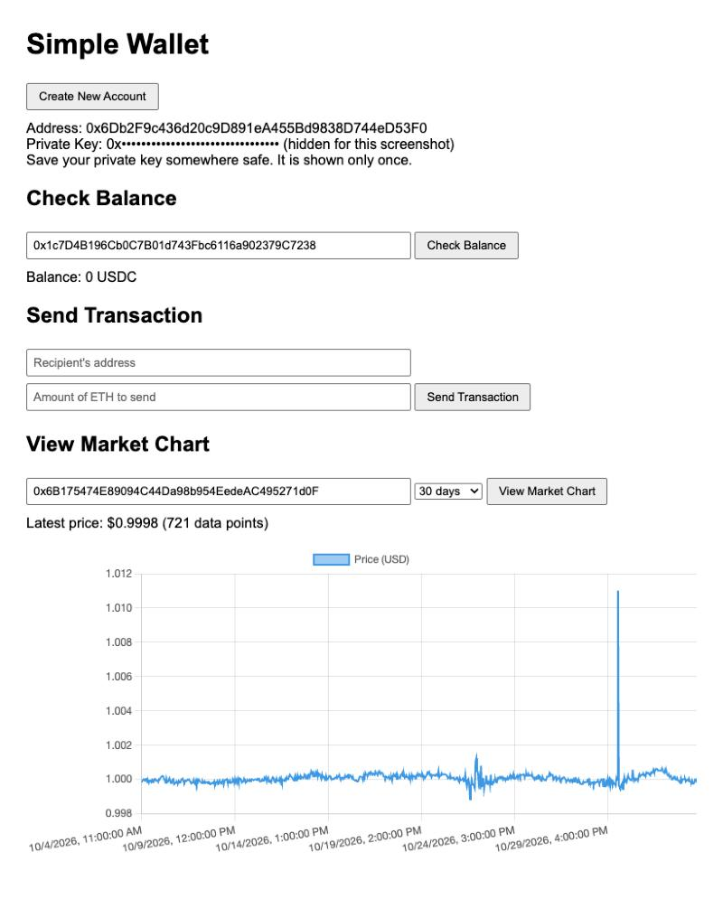

> Read the full article: [Developers' Guide: How to Build a Crypto Wallet Using Python](https://www.coingecko.com/learn/build-crypto-wallet-python)

# Ethereum Wallet Application

A simple Ethereum wallet built with Python, Flask and web3.py. It can:

- Create a new Ethereum account
- Show the account's ETH balance, or its balance of any ERC-20 token
- Send ETH to another address (EIP-1559 transaction)
- Fetch and chart a token's USD price history with the [CoinGecko API](https://www.coingecko.com/en/api)

The app connects to the **Sepolia testnet** by default, so you can test sending transactions with free test ETH.

> This is a learning project. Do not use it to hold real funds.

## Prerequisites

- Python 3.9 or higher
- An [Infura](https://www.infura.io/) API key (or any Ethereum JSON-RPC URL)
- A free [CoinGecko Demo API key](https://www.coingecko.com/en/api/pricing)

## Setup

```bash
git clone https://github.com/cg-growth/content.git
cd content/build-crypto-wallet-python

python3 -m venv .venv
source .venv/bin/activate   # Windows: .venv\Scripts\activate
pip install -r requirements.txt

cp env.example .env         # then fill in your keys
```

`.env` settings:

| Variable | Description |
| --- | --- |
| `FLASK_SECRET_KEY` | Any long random string, used to sign the Flask session |
| `INFURA_API_KEY` | Your Infura API key. The app connects to `https://sepolia.infura.io/v3/<key>` |
| `ETH_RPC_URL` | Optional. Any Ethereum JSON-RPC URL; overrides `INFURA_API_KEY` |
| `COINGECKO_DEMO_API_KEY` | Your CoinGecko Demo API key |

## Run

```bash
python app.py
```

Open `http://localhost:5000`. On macOS, if port 5000 is taken by AirPlay Receiver, run `PORT=5001 python app.py` and open `http://localhost:5001`.

## Try it

1. Click **Create New Account** and save the private key it shows.
2. Get free Sepolia ETH for the new address from a faucet, for example the [Google Cloud Sepolia faucet](https://cloud.google.com/application/web3/faucet/ethereum/sepolia).
3. **Check Balance**: leave the field blank for ETH, or enter a Sepolia token contract, such as USDC on Sepolia: `0x1c7D4B196Cb0C7B01d743Fbc6116a902379C7238`.
4. **Send Transaction**: enter a recipient address and an amount of ETH. Track the returned hash on [Sepolia Etherscan](https://sepolia.etherscan.io/).
5. **View Market Chart**: enter an Ethereum mainnet token contract, such as DAI: `0x6B175474E89094C44Da98b954EedeAC495271d0F`. Prices come from CoinGecko's [Coin Historical Chart Data by Token Address](https://docs.coingecko.com/reference/contract-address-market-chart) endpoint.

## Endpoints

- `GET /new_account`: Creates a new Ethereum account and returns the address and private key.
- `GET /balance`: Returns the ETH balance of the account in the session.
- `GET /balance/<contract_address>`: Returns the account's balance of an ERC-20 token, adjusted for the token's decimals.
- `POST /send_transaction`: Sends ETH. JSON body: `{"to": "0x...", "amount": "0.01"}`.
- `GET /market_chart/<contract_address>/<days>`: Returns the token's USD price, market cap and volume history from the CoinGecko API.

## Using the official CoinGecko Python SDK

`app.py` calls the CoinGecko API with `requests`. The same call with the official [CoinGecko Python SDK](https://docs.coingecko.com/docs/sdk-python) is included as a comment in `get_market_chart()`. To use it, run `pip install coingecko-sdk` and swap in the commented lines.

## Files

- `app.py`: The Flask back end.
- `erc20_abi.json`: The ERC-20 functions the app uses (`balanceOf`, `decimals`, `symbol`, `transfer`).
- `templates/index.html`: The user interface.
- `env.example`: Template for your `.env` file.

## Security notes

- Private keys are kept in server memory only and are lost when the app restarts. They are never stored in the session cookie.
- `app.py` runs Flask in debug mode for local development. Never expose it to the internet.

## Output


